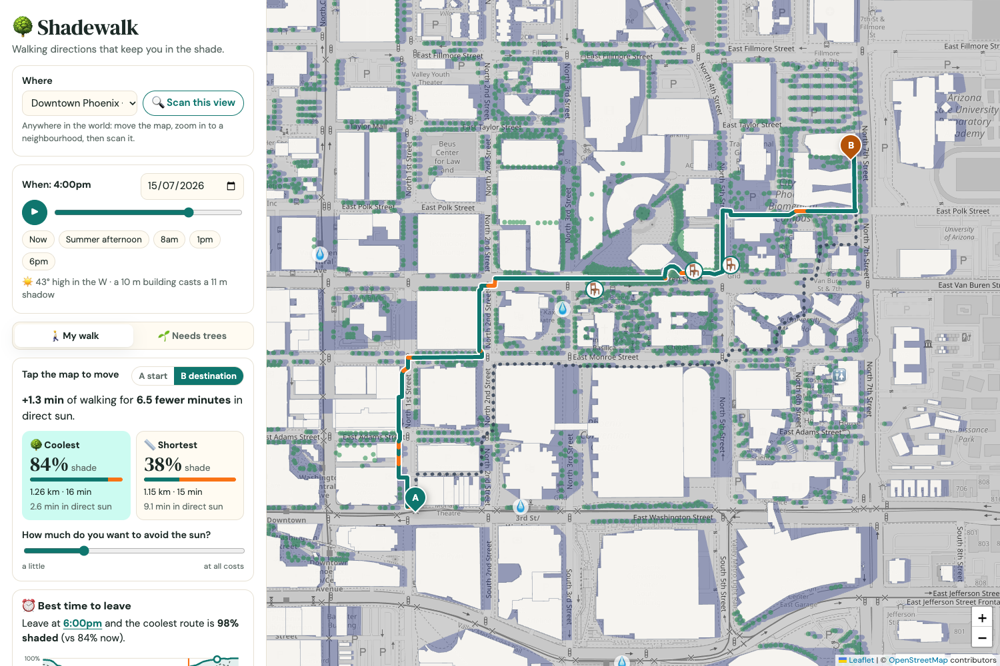

# 🌳 Shadewalk

**Walking directions that keep you in the shade.**

**▶ Try it: https://shadewalk-beta.vercel.app** (no sign-up, works on phones)



Extreme heat is one of the deadliest kinds of weather. Maricopa County (Phoenix) recorded **645 heat-associated deaths in 2023**,
and the people most exposed are the ones walking: kids on the way to school, older people, outdoor workers, and anyone who
can't afford a car. Map apps send everyone down the shortest street, even when it has no shade at 4pm.

Shadewalk works out where the shadows of buildings and trees fall at the moment you plan to walk, then finds the route that
keeps you out of the sun.

| | |
|---|---|
| 🌳 **Coolest vs shortest** | In downtown Phoenix on a July afternoon, the shortest route is 38% shaded. The coolest is **84% shaded for 1.3 extra minutes**, which means 6.5 fewer minutes in direct sun. |
| 🛣️ **The shady sidewalk** | On wider roads Shadewalk checks both sidewalks and walks you on the shadier one. |
| 🌡️ **Real heat warnings** | The actual "feels like" temperature for that place and time (Open-Meteo forecast, or recorded data for past days), with US National Weather Service danger levels. Phoenix on 15 July 2026 at 4pm: 40 °C, feels like 41 °C, **Danger**. |
| 🧭 **Turn-by-turn** | "Turn right onto East Van Buren Street · 285 m · shady · walk on the north side." |
| ♿ **Step-free and your pace** | Avoid stairs (wheelchairs, strollers), and pick a slower pace for kids or older walkers. |
| ⛱️ **Covered walkways** | Arcades, colonnades and passages under buildings count as shade (2.2 km of them in downtown Phoenix). |
| ⏰ **Best time to leave** | A chart of shade on both routes from sunrise to sunset, plus a tip like "leave at 6:00pm and it's 98% shaded". |
| ▶ **Play the day** | Watch the shadows sweep across the streets from sunrise to sunset. |
| 🧊 **Cool stops** | Drinking water, shelters, libraries, toilets and benches along your route. |
| 🌱 **Streets that need trees** | A sun/shade map of every street, plus a ranked list of "sun traps": the longest streets in full sun. Download them as a CSV or copy a ready-made letter to your city council asking for trees or shade. |
| 🔍 **Anywhere in the world** | Phoenix and Barcelona are built in. Zoom into any neighbourhood and tap *Scan this view* to download its buildings, trees and streets from OpenStreetMap. |

No API keys, no accounts, no tracking. Routes (with options) live in the URL. Tap 🔗 Share route or 📍 Me to start from where you are.

## How it works

1. **Where's the sun?** `src/lib/sun.ts` computes the sun's altitude and compass direction for any place and time with standard astronomical formulas (the same ones SunCalc uses). It's checked against known values: about 80° at noon on the June solstice in Phoenix, about 33° at noon in December.
2. **What casts shade?** `src/lib/osm.ts` turns OpenStreetMap data into buildings with heights (from `height`, else floors × 3.2 m, else a typical height for the building type) and tree canopies. Palms get a tiny canopy, because they barely shade you. It also builds the walking network and finds the cool stops.
3. **Is this spot in shade?** `src/lib/shade.ts` casts a ray from the point towards the sun. A building of height *h* can only block the sun within *h* / tan(altitude) metres, so the ray is tested against footprints within that distance, using a spatial grid. Trees are canopy discs between 35% and 100% of their height. Every street is sampled every 5 m, on both sidewalks for wider roads. The whole 144 km downtown Phoenix network takes **30–80 ms**, so it updates live as you drag the time slider.
4. **Which route?** `src/lib/route.ts` runs A* with the cost *length × (1 + heat × share in sun)*. Heat = 0 gives the shortest route, and the "how much do you want to avoid the sun?" slider raises it.
5. **Directions and heat.** `src/lib/directions.ts` groups the route into streets and turns and names the shadier sidewalk by compass side. `src/lib/weather.ts` fetches hourly temperature and "feels like" values from Open-Meteo and grades them with NWS heat-index categories.
6. **Drawing it.** A custom Leaflet canvas layer draws thousands of buildings, trees and shadows in a few milliseconds. All shadows go into one path that's filled once, so overlapping shade doesn't get darker.

`api/overpass.ts` is a small Vercel function that proxies OpenStreetMap's Overpass API for *Scan this view*. Overpass rejects browser user agents and is often busy, so the proxy sends a descriptive user agent and falls back to mirrors.

```bash
npm install
npm run dev          # http://localhost:5173
npm test             # sun, geometry, OSM parsing, shadows, routing, analysis
npm run build
node scripts/fetch-area.ts <id> "<Name>" "<City>" <IANA time zone> <s,w,n,e>   # add a built-in area
```

## Limits

- Shadewalk only knows what's mapped. Missing trees can't cast shade, and buildings without a height get an estimate, so real streets may be a bit shadier than shown.
- Mapped arcades and covered walkways count as shade, but awnings, bus shelters and terrain aren't modelled yet.
- Shade isn't the only thing that matters in heat. Carry water, and on extreme heat days walk early or late if you can.

## Credits

Map data © OpenStreetMap contributors (ODbL). Map tiles © OpenStreetMap. The sun-position formulas follow SunCalc by Vladimir Agafonkin and Astronomy Answers.
I built this with Claude (Anthropic) as a coding assistant. See [SUBMISSION.md](SUBMISSION.md) for the full AI-use disclosure.

Made for Code for Change 2026. MIT licensed.
