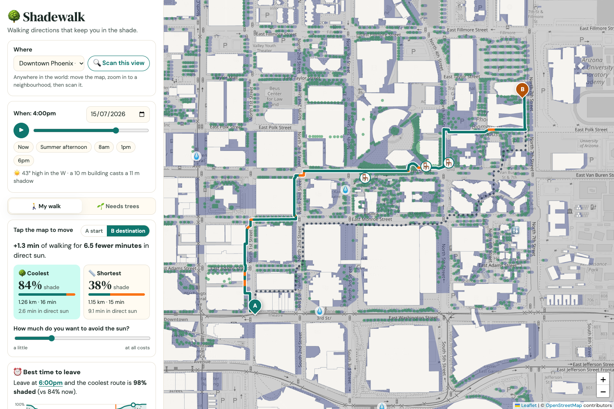

# Devpost submission: Code for Change 2026

Paste-ready answers in first person. Replace anything in [brackets].

## Project name (56/60)
Shadewalk: walking directions that keep you in the shade

## Elevator pitch (under 200)
Map apps send you down the shortest street, even with no shade at 4pm. Shadewalk models building and tree shadows in real time to find the coolest walking route, and maps streets that need trees.

## About the project

```markdown
## Inspiration
Extreme heat is one of the deadliest kinds of weather. Maricopa County, home to Phoenix, recorded **645 heat-associated deaths in 2023**. The people most exposed aren't in cars. They're walking: kids on the way to school, older people going to the shops, outdoor workers, and anyone who can't afford to drive.

Every map app sends them down the *shortest* street, even when it's a sunbaked six-lane road at 4pm and the next street over is lined with trees. The US EPA notes that shaded surfaces can be **11–25 °C cooler** than unshaded ones. I wanted directions that know where the shade is.



## What it does
Pick a start, a destination and a time, and Shadewalk shows two routes:

- 🌳 **The coolest route** next to 📏 **the shortest one**. In downtown Phoenix on a July afternoon, the shortest route is 38% shaded. The coolest is **84% shaded for 1.3 extra minutes**, which means 6.5 fewer minutes in direct sun.
- 🛣️ **The shady sidewalk.** On wider roads it checks both sidewalks and walks you on the shadier one.
- ⏰ **Best time to leave.** A chart of shade on both routes from sunrise to sunset: "Leave at 6:00pm and it's 98% shaded."
- ▶ **Play the day.** Watch the shadows sweep across the city from sunrise to sunset.
- 🧊 **Cool stops** along the route: drinking water, shelters, libraries, toilets and benches.

It also helps communities push for change:
- 🌱 **Streets that need trees.** A sun/shade map of every street and a ranked list of "sun traps", the longest streets in full sun. You can download them as a CSV or **copy a ready-made letter to your city council** asking for street trees or shade structures, with the numbers filled in.

It works **anywhere**. Phoenix and Barcelona are built in, and *Scan this view* downloads buildings, trees and streets for any neighbourhood on OpenStreetMap. There are no API keys, no accounts and no tracking, and routes live in the URL so they can be shared.

## How I built it
- **Sun position.** I implemented the standard astronomical formulas for the sun's altitude and compass direction at any place and time, and tested them against known values: about 80° at noon on the June solstice in Phoenix, about 33° in December.
- **OpenStreetMap → 3D city.** A parser turns OSM data into buildings with heights (explicit height, else floors × 3.2 m, else a typical height for the building type), tree canopies, the walking network and cool stops. Palms get a tiny canopy, because they barely shade you.
- **The shadow engine.** To decide whether a point is in shade, I cast a ray towards the sun. A building of height \\(h\\) can only block it within \\(h / \tan(\text{altitude})\\) metres, so I test that segment against nearby footprints using a spatial grid. Trees are canopy discs between 35% and 100% of their height. Every street is sampled every 5 m (on both sidewalks for wider roads). The whole 144 km downtown Phoenix network takes **30–80 ms**, so shadows and routes update live as you drag the time slider.
- **Routing.** A* search where each segment costs

$$\text{cost} = \text{length} \times (1 + \text{heat} \times \text{share in sun})$$

Heat 0 gives the shortest path, and the "how much do you want to avoid the sun?" slider raises it.
- **Map.** React + Leaflet, with a custom canvas layer that draws thousands of buildings, trees and shadows in a few milliseconds. All shadows are one path filled once, so overlapping shade doesn't look darker.
- **Scanning new areas** goes through a small Vercel serverless proxy to the Overpass API, with retries and mirrors.
- **Tests** cover the sun maths, geometry, OSM parsing, shadow casting (a 10 m building at a 45° sun casts exactly a 10 m shadow), routing and the analysis.

## Challenges I ran into
- **Speed.** Ray-casting every 5 m of 144 km of streets sounded too slow for a slider. A spatial grid, quick bounding-box rejects and limiting each building's reach to \\(h/\tan\\) of the altitude got it to well under 100 ms.
- **Overlapping shadows.** Drawing each shadow separately made overlaps look darker, as if some places had "double shade". Filling every shadow as one path fixed it.
- **OpenStreetMap's servers.** Scanning failed with what looked like CORS errors. The real cause was that Overpass rejects generic browser user agents with a 406, and busy responses carry no CORS headers. A small server-side proxy with a descriptive user agent and a 48-second budget (a neighbourhood can take 35 s) fixed it.
- **Map tiles.** The basemap I first used started requiring an API key. I switched to standard OpenStreetMap tiles and used a CSS filter to mute them so the shadows stand out.
- **Missing data.** Many buildings have no height and many trees aren't mapped. I estimate heights from floors or building type, and I say clearly in the app that real streets may be shadier.

## What I learned
- How to compute the sun's position, and how shadow length grows as the sun drops: a 10 m building casts an 11 m shadow at 43° but a 45 m shadow at 13°.
- Spatial indexing and ray casting, and why performance work matters for interactive tools.
- How rich, and how patchy, open map data is: downtown Phoenix has over 3,000 mapped trees.
- Shade is a fairness issue. The streets with no trees are often the ones people *have* to walk.

## What's next
- Awnings, arcades and bus shelters, plus tree data from city open-data portals.
- Heat forecasts, so it can warn on dangerous days and plan around the hottest hours.
- A "school routes" mode so parents and schools can map the coolest walks to school.
- Working with community groups to send sun-trap reports to councils.
```

## Built with
typescript, react, vite, leaflet, openstreetmap, overpass-api, html5-canvas, vercel, serverless, node.js, css, claude

## "Try it out" links
- https://shadewalk-beta.vercel.app
- https://github.com/shineyrbl-byte/shadewalk

## AI-use disclosure (long)
I used Claude (Anthropic), through Claude Code, as a coding assistant. We brainstormed the idea together after looking at my past projects. Claude wrote much of the first version of the code (sun maths, OSM parser, shadow engine, routing, React UI), which I reviewed, tested and asked it to change. It wrote unit tests and ran automated browser screenshots, which caught several bugs (an API-key watermark on the map, a broken proxy, a timeout too short for OpenStreetMap). It also helped draft this write-up, which I edited. I can explain how every part works.

## AI-use disclosure (under 255 characters)
Yes. I used Claude (Anthropic) via Claude Code to brainstorm, write much of the code, write tests, run browser checks and draft the write-up. I designed the features, reviewed and tested everything, and can explain how it all works.

## Team members
[Your name]

## Gallery (docs/gallery, 1500×1000)
1-coolest-vs-shortest, 2-shadows-up-close, 3-best-time-to-leave, 4-streets-that-need-trees, 5-letter-to-the-council, 6-barcelona, 7-evening-long-shadows, 8-on-your-phone

## Optional demo video script (about 1:30)
| Time | Screen | Voiceover |
|---|---|---|
| 0:00–0:10 | Phoenix, 4pm, both routes | "In 2023, 645 people died from heat in the county around Phoenix. Map apps still send walkers down the shortest street, shade or not." |
| 0:10–0:30 | Zoom into the shadows | "Shadewalk works out where the sun is right now and casts shadows from every mapped building and tree." |
| 0:30–0:45 | Route cards | "The coolest route is 84% shaded instead of 38%, for one extra minute of walking." |
| 0:45–1:00 | Press ▶ Play | "Watch the shadows move through the day, and see the best time to leave." |
| 1:00–1:15 | Needs trees tab + letter | "For communities, it ranks the streets with no shade and writes a letter to the council asking for trees." |
| 1:15–1:30 | Scan this view somewhere new | "And it works for any neighbourhood on OpenStreetMap. Shadewalk: walk in the shade." |
